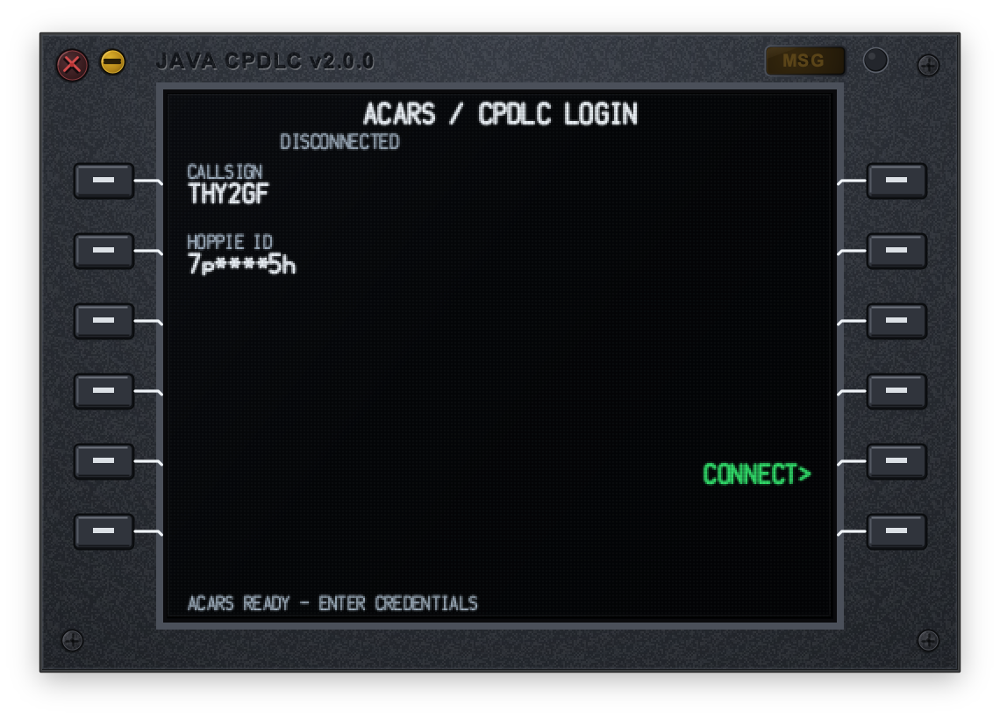
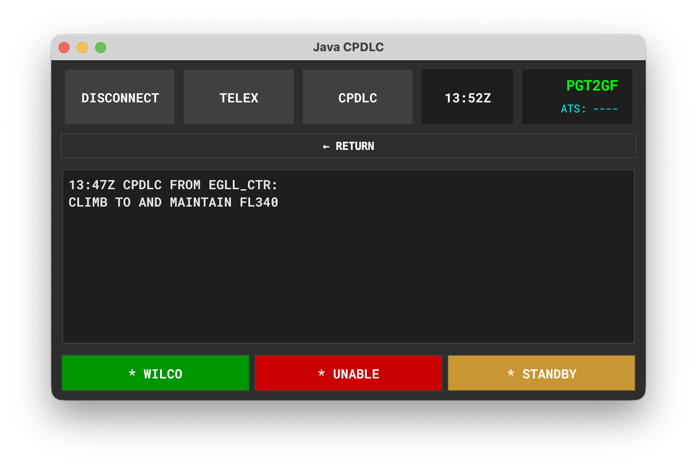
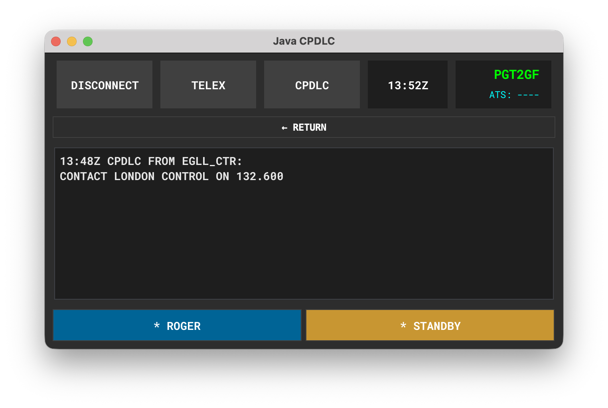
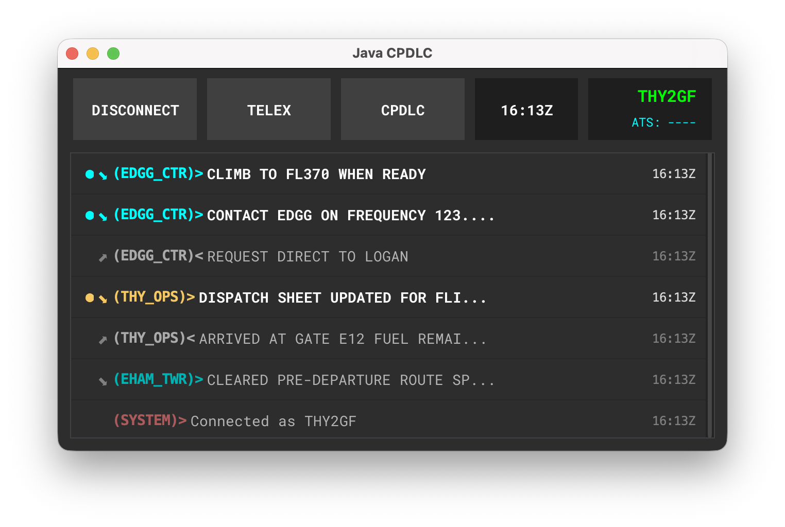
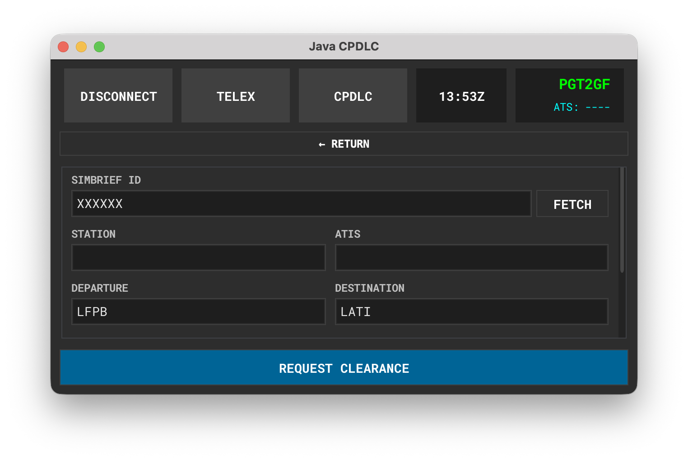
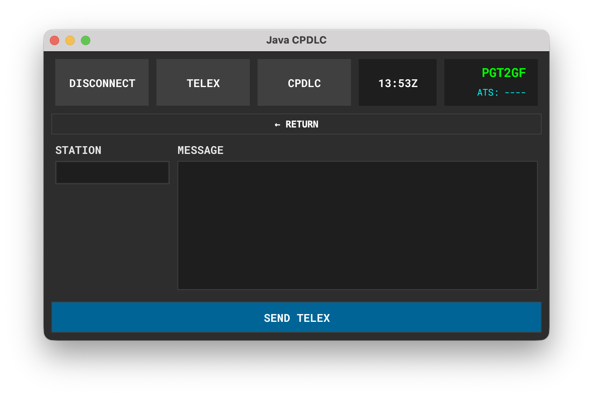

# Java CPDLC
Java CPDLC is a multi-platform CPDLC Client for HoppieAcars. 
It is written on Java so you can use it on any platform (Windows/Linux/macOS).

With version 2.0.0, Java CPDLC features a brand new **CDU style GUI** as the default interface. The **legacy GUI** remains available as well. Active development and future bug fixes are focused on the CDU style GUI; the legacy interface will remain available, though bugs may occur.

<p align="center">
  <br>
  <sub><b>New CDU Style Interface (v2.0.0+)</b></sub>
</p>

<p align="center">
  <sub><b>Legacy GUI Screenshots:</b></sub><br>
  <a href="src/resources/images/screenshot1.png"></a>
  <a href="src/resources/images/screenshot2.png"></a>
  <a href="src/resources/images/screenshot3.png"></a>
  <a href="src/resources/images/screenshot4.png"></a>
  <a href="src/resources/images/screenshot5.png"></a>
</p>


## ⚡ Quick Start (For Non-Developers)
If you don't want to deal with coding or building, just download the pre-compiled version:
1. Go to the **Releases** section on the right.
2. Download the latest release (the default release packages the new CDU style GUI; legacy packages are also provided).
3. **Double-click** to run (Make sure you have Java 8 or higher installed).
   - For Windows: Use the installer to install.
   - For macOS: Drag the app to Applications folder.

## 🔨 Building & Running
The project uses **Maven** for the build process, so no manual library downloads are required. Make sure Maven is installed on your system.

1. **Compile:** Open your terminal in the **main project folder** (where the `pom.xml` file is located) and run:
   ```bash
   mvn clean package
   ```
2. **Run:** After the build is complete, you can find executable JAR files in the `target/` folder:
   - **CDU Style GUI (Default)**:
     ```bash
     java -jar target/java-cpdlc-2.0.0.jar
     ```
   - **Legacy GUI**:
     ```bash
     java -jar target/java-cpdlc-2.0.0-legacy.jar
     ```
   
## Usage
1. Once compiled and run, you should have a login page. You need to put in your callsign and Hoppie ID. Click SAVE button
2. Thereafter, everything should be pretty straight forward.

- If your callsign is in green color, the connection with Hoppie server has established.
- If any connection problem occurs your callsign will become red.

### Message Color Coding
- **Blue**: CPDLC messages
- **Yellow**: Telex messages
- **Red**: System messages (Mostly related to Hoppie connection )

### Automatic CPDLC Handover & Logoff
Incoming ATC handover instructions and logoff messages are processed automatically
- **Handover**: Automatically requests a logon to the next ATS unit and logs off from the previous station once accepted.
- **Logoff**: Automatically disconnects from the active ATS unit upon receiving a service termination message.


## Contribution
As of now, the code doesn't have javadoc so it's a bit of mess. I will for sure write javadoc and necessary comments to the code. 

However, any pull requests are still welcome. See below what I am currently working on. 

#### Features to implement
- Oceanic Clearance implementation

